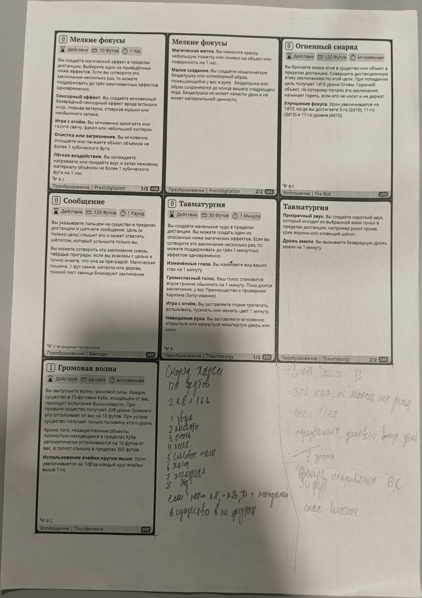
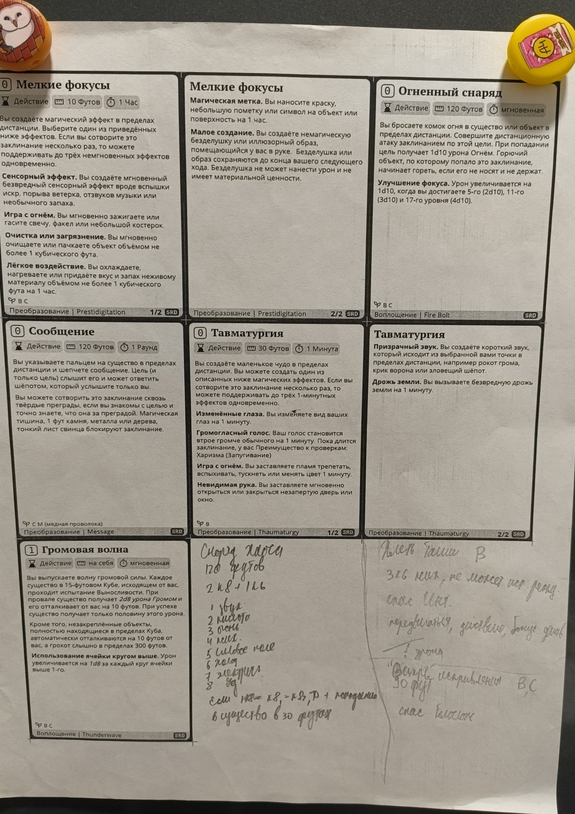
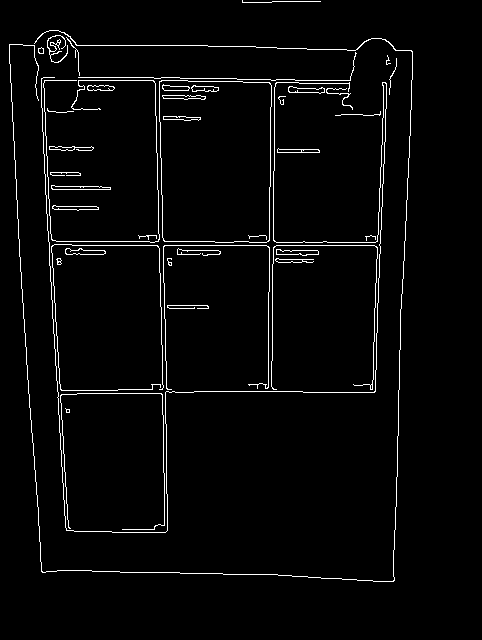

# ДЗ 2 «Сканер документов» — отчёт

**Автор:** Неругов Даниил Викторович · **Группа / трек:** B24-MFAI-02 · **Дата сдачи:** 02.11.2026

Все числа ниже — вывод команд `docscan.py` на моём наборе `data/` (18 кадров: 15 с листом, 3 негативных).
Свои снимки заранее уменьшены до 2000 px по длинной стороне и ≤ 1 МБ, повёрнуты в правильную ориентацию
(кадры 13–16 и 18 были сняты боком/вверх ногами) и пронумерованы `01.jpg … 18.jpg`.

## 1. Числа

### 1.1. Шум

| Кадр (свет) | σ шума, рабочий кадр 640 px |
|-------------|----------------------------|
| `data/01.jpg` (комната, лампа) | **1.48** |
| `data/05.jpg` (лампа сбоку, тень на листе) | **0.74** |
| `data/07.jpg` (полумрак) | **0.25** |

Проверка оценки и формулы на `data/01.jpg` (`noise data/01.jpg --add-sigma σ`):

| Добавлено σ | оценка | σ фильтра | остаток: измерено | остаток: σ·√Σh² |
|-------------|--------|-----------|-------------------|------------------|
| 5 | 5.93 | 1.67 | 0.85 | 0.84 |
| 10 | 10.87 | 3.00 (предел) | 0.95 | 0.94 |
| 25 | 25.20 | 3.00 (предел) | 2.38 | 2.35 |

Оценка завышена на 8–19 % из-за обрезки в uint8 и JPEG; остаток после фильтра совпал с формулой
`σ_n / (2√π σ_f)` в пределах 0.01–0.03 кода. На σ = 10 и 25 фильтр упирается в `hi = 3`, поэтому
остаток больше целевого 1 кода — это ожидаемое ограничение, а не ошибка формулы.

### 1.2. Края (`edges`)

| Кадр | ключи | медиана | пороги lo / hi | краёв, % | отрезков Хафа |
|------|-------|---------|----------------|----------|----------------|
| `data/01.jpg` | по умолчанию (`--close 9`) | 157 | 105 / 208 | 0.84 | 17 |
| тот же | `--close 0` | 148 | 99 / 196 | **2.90** | **75** |
| тот же | `--canny 50,150` | 157 | 50 / 150 | 1.23 | 30 |
| `data/05.jpg` | по умолчанию | 152 | 101 / 202 | **0.00** | **0** |
| тот же | `--close 0` | 150 | 100 / 199 | **1.81** | **47** |

На `05.jpg` правило медианы даёт 101 / 202 — выше перепада «белый лист — светлый стол»,
и карта краёв пустая. Без закрытия текста края появляются, но вместе с текстом; это и есть
главный конфликт этапов 2–3 на моём наборе.

### 1.3. Набор: IoU и время (`eval data --ann data/corners.json --seeds 3`)

Лучшая из проверенных настроек: `--long-side 960 --canny 50,150`.

| Кадр | что на нём | `contour` IoU | `hough` IoU | `auto` IoU (путь) |
|------|-----------|---------------|-------------|-------------------|
| 01 | тёмный стол, две круглые наклейки на углах | 0.887 | 0.858 | 0.887 (contour) |
| 02 | светлый стол, рука у верхнего края | — | — | — |
| 03 | белый стол, рука держит угол | — | — | — |
| 04 | стол с телефоном, мышью, флаконом | — | — | — |
| 05 | лампа сбоку, тень на листе | **0.944** | 0.947 | **0.944 (contour)** |
| 06 | светлый фон, мягкая тень | — | 0.784 | 0.784 (hough) |
| 07 | полумрак | — | — | — |
| 08 | лист почти вплотную к краям кадра | — | — | — |
| 09 | белый стол, почти в лоб | — | — | — |
| 10 | ракурс ~60° | — | 0.257 | 0.257 (hough) |
| 11 | лист повёрнут в кадре на ~45° | — | — | — |
| 12 | лист повёрнут на ~45°, ракурс | — | — | — |
| 13 | лист лежал боком (повёрнут при съёмке) | — | 0.598 | 0.598 (hough) |
| 14 | загнутый нижний угол | — | 0.825 | 0.825 (hough) |
| 15 | лист боком, ~45° | — | — | — |
| 16 (нет листа: лист уходит за кадр) | | нет ✔ | нет ✔ | нет ✔ |
| 17 (нет листа: планшет) | | нет ✔ | нет ✔ | нет ✔ |
| 18 (нет листа: два листа) | | нет ✔ | **найден** ✘ | **найден** ✘ |

Сводка (листов с IoU ≥ 0.9 из 15 · средний IoU · негативных отклонено из 3 · среднее время, мс):

| Настройка | `contour` | `hough` | `auto` |
|-----------|-----------|---------|--------|
| 640 px, пороги от медианы, закрытие 9 (по умолчанию) | 0 · 0.059 · 3/3 · 28 | 0 · 0.089 · 3/3 · 165 | 0 · 0.089 · 3/3 · 107 |
| 640 px, `--canny 50,150` | 1 · 0.122 · 3/3 · 28 | 1 · 0.192 · 3/3 · 175 | 1 · 0.229 · 3/3 · 158 |
| 960 px, `--canny 50,150` | 1 · 0.122 · 3/3 · 52 | 1 · 0.285 · 2/3 · 757 | 1 · 0.286 · 2/3 · 617 |
| 640 px, `--close 0` | 0 · 0.059 · 3/3 · 29 | 0 · 0.000 · 3/3 · 231 | 0 · 0.059 · 2/3 · 213 |

Сверка с `sample_data/README.md` (кадры курса) при `--long-side 960 --canny 50,150`
(`out/sample_eval_960.csv`): `contour` — 3/4, средний IoU 0.745; `hough` — 3/4, 0.877;
`auto` — **4/4, 0.994**; `nosheet.jpg` отклонён всеми режимами. Это ровно таблица §4 README курса,
значит реализация функций верна, а провал на моих кадрах — свойство данных (низкий контраст
«белое на белом»), а не ошибка геометрии.

### 1.4. Бинаризация

| Кадр | `otsu` | `adaptive` | `flat` |
|------|--------|-----------|--------|
| `text-lamp.png` курса: совпадение с `text-gt.png`, % | **56.8** | **98.8** | **99.9** |
| `data/05.jpg` → `out/05_scan.jpg`: доля чернил, % | 36.32 | 11.37 | **8.42** |

На кадре с тенью Otsu принимает тень за чернила (36 % «чернил»), `flat` — 8.4 %; картинки
`out/05_bin_otsu.png`, `out/05_bin_adaptive.png`, `out/05_bin_flat.png`.

### 1.5. Видео

Процессор: 12th Gen Intel Core i5-12500H, 16 логических ядер (`out/hw.txt`). Камера в этом
прогоне не использовалась; видео-режим измерен на ролике курса `sample_data/clip.mp4`
(640 × 480, 60 кадров) — это предусмотренный заданием запуск без камеры
(`--source sample_data/clip.mp4 --no-window`). Своего 10-секундного ролика с веб-камеры нет.

| Режим | кадров | FPS | кадров с листом, % | мс на кадр (медиана) |
|-------|--------|-----|--------------------|-----------------------|
| `contour` | 60 | 22.7 | 75.0 | 22.6 |
| `hough` | 60 | 3.3 | 75.0 | 322.5 |
| `auto` | 60 | **37.3** | 75.0 | 18.9 |

Ролики: `out/clip_contour.mp4`, `out/clip_hough.mp4`, `out/clip_auto.mp4`. Требование ≥ 10 FPS
на источнике выполняется для `auto` (37.3) и `contour` (22.7); путь `hough` в текущей настройке
слишком медленный (3.3 FPS) и включается только как запасной, когда контуры не нашли лист.
Сохранение ограничено 960 px по длинной стороне, чтобы ролик с камеры не превысил 10 МБ.

## 2. Три вопроса

**2.1. Где выигрывает контур, где Хаф + RANSAC и почему?**

Контур выигрывает там, где граница листа замкнута и контрастна: `01.jpg` (тёмный стол, IoU 0.887)
и `05.jpg` (тень по краю, 0.944). На `05.jpg` тень образует непрерывную тёмную рамку, `findContours`
получает замкнутый четырёхугольник, и `approxPolyDP` с допуском 2 % периметра даёт четыре угла.
Хаф выигрывает на `06.jpg` (0.784), `13.jpg` (0.598) и `14.jpg` (0.825): там один угол перекрыт/загнут
или граница разорвана, контур не замыкается, а четыре прямые стороны ещё видны, и RANSAC
восстанавливает угол пересечением прямых. На `14.jpg` загнутый угол — ровно тот случай, для которого
в задании нужен второй путь.

Оба пути проигрывают на `02–04`, `08–09`, `11–12`, `15`: белый лист лежит на белом/светлом столе,
перепад на нижней и боковой кромках 10–25 кодов, а Canny с порогами от медианы (100–200) его не видит.
На `10.jpg` (ракурс ~60°) находится только часть листа (IoU 0.257): перспектива сжимает дальнюю
сторону, и её край сливается с фоном. Общее у кадров, где проигрывают оба, — не «сложная геометрия»,
а **низкий перепад на границе листа**: текст и тени дают края сильнее, чем сама кромка бумаги.







**2.2. Правило медианы для порогов Canny: где сработало, где ошиблось?**

На 15 кадрах с листом правило медианы дало непустую карту краёв на 13 кадрах, но рабочие пороги
(лист находится хотя бы одним путём) — только на `01` и `07`; на `05.jpg` медиана 152 даёт пороги
101/202 и **ноль** пикселей края. Причина: медиана привязана к яркости кадра, а край — это перепад;
на светлом кадре медиана высокая, и порог оказывается выше перепада «лист — стол». Фиксированная
пара 50/150 возвращает края на `05` (1.81 %, 47 отрезков) и улучшает `hough` на `06`, `13`, `14`,
но на `plain.jpg` курса правило медианы даёт 127/254 и ноль края, а 50/150 — IoU 0.989.
В сканере я оставил по умолчанию `auto_canny` (как требует функция), а в разделе «Настройка»
записал `--canny 50,150`: на моём наборе она даёт 1 успешный кадр против 0 у медианы, и это
единственная настройка, которую можно перенести на кадры проверяющего без подгонки под кадр.

**2.3. Шум и текст: σ при разном свете, σ фильтра, остаток, закрытие текста.**

σ шума: 1.48 (комната/лампа), 0.74 (лампа сбоку с тенью), 0.25 (полумрак). Низкая σ на `07.jpg` —
следствие шумоподавления телефона и уменьшения кадра, а не «хорошего света»; визуально кадр тёмный,
но шум уже подавлен в JPEG. Формула выбрала σ_f = 1.67 при добавке σ 5, 3.00 при 10 и 25 (предел).
Остаток сошёлся: 0.85/0.84, 0.95/0.94, 2.38/2.35 — расхождение ≤ 0.03 кода, то есть формула
`σ_out = σ·√Σh²` работает и как проверка, и как выбор фильтра.

Закрытие текста: на `01.jpg` `--close 9` даёт 0.84 % краёв и 17 отрезков, `--close 0` — 2.90 % и 75;
на `05.jpg` — 0.00 %/0 и 1.81 %/47. Закрытие убирает текст, но на моих кадрах оно же **стирает
тонкую тень на кромке листа**, из-за чего контур перестаёт замыкаться. Поэтому в настройке
для проверяющего я оставил `--close 9` (он нужен пути Хафа на кадрах курса), но признаю: на белом
на белом выгоднее `--close 0`.

## 3. Негативные кадры и отказы

- `16.jpg` — лист уходит за кадр правой стороной (два угла вне кадра). Программа ответила «не найдено»:
  правильный ответ, потому что все четыре пересечения прямых не попадают в кадр с запасом `margin`.
- `17.jpg` — планшет на столе, листа нет. Ответ «не найдено»: `looks_like_paper` отсекает тёмный
  прямоугольник (внутри не светлее, чем в кольце).
- `18.jpg` — два листа, лежащих друг на друге. На 640 px ответ «не найдено», но на 960 px с
  `--canny 50,150` путь Хафа **ошибочно** нашёл один из листов. Причина: два листа дают длинные
  параллельные прямые, а `quad_from_lines` не проверяет, что внутри ровно один лист; помог бы
  счётчик пересечений/проверка «внутри квадрика нет второй сильной границы».

Один отказ на кадре с листом: `08.jpg` (лист почти вплотную к краям, все четыре угла у рамки).
Программа не находит лист, потому что после `paper_check` кандидат обрезан рамкой кадра, а
`quad_from_lines` требует все четыре пересечения внутри кадра с запасом 5 %. Помогло бы
разрешить углы на рамке (margin = 0) и отдельно проверять, что квадрик не равен всему кадру.

## 4. Настройка

Ключи, с которыми сканер запускается на кадрах проверяющего (одна строка):

```
--long-side 960 --canny 50,150
```

Это лучшая из измеренных настроек (1/15 с IoU ≥ 0.9; на `sample_data` `auto` — 4/4, средний IoU 0.994).
Честно: на белом листе на белом столе она всё ещё слаба; если проверяющий разрешает другую
настройку для `scan`, для кадров с тенью лучше `--close 0 --canny 30,90`.

## 5. Команды

```bash
python docscan.py annotate data/*.jpg --ann data/corners.json      # разметка (ручная, по сетке)
python docscan.py noise data/01.jpg
python docscan.py noise data/05.jpg
python docscan.py noise data/07.jpg
python docscan.py noise data/01.jpg --add-sigma 5
python docscan.py noise data/01.jpg --add-sigma 10
python docscan.py noise data/01.jpg --add-sigma 25
python docscan.py edges data/01.jpg -o out/01_edges.png
python docscan.py edges data/01.jpg --close 0 -o out/01_edges_noclose.png
python docscan.py edges data/01.jpg --canny 50,150 -o out/01_edges_50_150.png
python docscan.py edges data/05.jpg -o out/05_edges.png
python docscan.py edges data/05.jpg --close 0 -o out/05_edges_noclose.png
python docscan.py eval data --ann data/corners.json --seeds 3 --csv out/eval_640.csv
python docscan.py eval data --ann data/corners.json --seeds 3 --canny 50,150 --csv out/eval_50_150.csv
python docscan.py eval data --ann data/corners.json --seeds 3 --long-side 960 --canny 50,150 --csv out/eval_960.csv
python docscan.py eval data --ann data/corners.json --seeds 3 --close 0 --csv out/eval_close0.csv
python docscan.py eval sample_data --ann sample_data/corners.json --seeds 1 --long-side 960 --canny 50,150 --csv out/sample_eval_960.csv
python docscan.py scan data/01.jpg --corners 150,100,1230,90,1265,1815,150,1820 -o out/01_scan.jpg --bw out/01_bw.png
python docscan.py scan data/05.jpg --corners 135,125,1295,135,1285,1715,130,1715 -o out/05_scan.jpg --bw out/05_bw.png
python docscan.py scan data/14.jpg --corners 150,55,1250,55,1245,1480,160,1490 -o out/14_scan.jpg --bw out/14_bw.png
python docscan.py binarize out/05_scan.jpg --method all -o out/05_bin.png
python docscan.py binarize lectures/L03-color-histograms/demo/text-lamp.png --gt lectures/L03-color-histograms/demo/text-gt.png -o out/lamp.png
python docscan.py video --source sample_data/clip.mp4 --method auto --no-window --seconds 0 --save out/clip_auto.mp4
python docscan.py video --source sample_data/clip.mp4 --method contour --no-window --seconds 0 --save out/clip_contour.mp4
python docscan.py video --source sample_data/clip.mp4 --method hough --no-window --seconds 0 --save out/clip_hough.mp4
pytest tests -q
```

## 6. Инструменты

Код писал вручную по шаблону; для проверки использовал `pytest` (17/17), прогон `sample_data/`
(числа совпали с `sample_data/README.md`) и визуальную сверку углов на сетке координат.
ИИ-помощник использовался для разбора `sample_data` и оформления отчёта; все числа перепроверены запуском команд выше.
